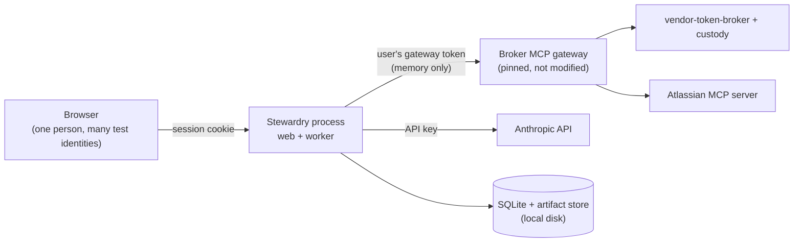

# Threat model

Status: updated for Milestone 1, step S4a (access mapping and task grants), 2026-10-10. Each milestone
step that adds behavior updates this file in the same pull request.

This document states what Stewardry protects, where its trust boundaries
are, and what it does **not** claim. It does not inherit any claim from
vendor-token-broker or any other project.

## Assets

| Asset | Why it matters |
|---|---|
| Users' gateway-scoped hub credentials | They let the gateway act as that user at Atlassian |
| Confidential synthetic policy passages and their provenance | Reviewer-only, and must not reach Sales views, exports, or status text |
| Approval records bound to answer revisions | They decide what is released to Sales |
| The audit log and its anchors | Evidence for every control claim |
| The Anthropic API key and the hub client secret | They spend money and identify the application |
| Customer scope of tasks, drafts, and library entries | Cross-customer leakage is a zero-tolerance failure |

## Trust boundaries

1. **Browser → Stewardry.** Only an opaque session cookie crosses this
   boundary. Hub tokens never reach the browser (ADR 0005).
2. **Stewardry → gateway.** Stewardry holds the user's gateway token in
   memory and nowhere else. It never holds vendor tokens and never calls the
   broker directly (ADR 0006).
3. **Stewardry → Anthropic.** The model receives only permitted passages,
   never credentials, MCP tools, or other users' data (ADR 0003).
4. **Stewardry → local disk.** A local administrator controls the database,
   the anchors, and the code (ADR 0004).

## Main threats and planned controls

| Threat | Planned control | Lands in |
|---|---|---|
| Prompt injection in questionnaires or NDAs | Text treated as data; authorization checked on every call; the model cannot approve; screening only supplements | S5, S9, S11, Milestone 2 |
| Wrong acting user or identity swap | Task grants bound to the authorizing subject. The acting identity comes only from the active grant, never from task fields. A missing credential, an expired or revoked grant, a paused agent, or a lost customer assignment pauses the task with no fallback. Mutation-tested in S4a | S4a, S4b, S5 |
| Cross-customer access | Customer assignments in the access mapping, checked at submission, at authorization, and again when a run acquires its identity | S4a, S5 |
| Self-authorization (one person acting as both requester and reviewer) | The requester cannot authorize their own task, even if they hold a drafting role | S4a |
| Changed hub subject reusing a known username | Sign-in is refused until a platform engineer re-maps it with an explicit flag. The old row keeps its history | S4a |
| Over-broad Atlassian reads (`executeRead`, `discover`) | Per-agent policy and platform baseline denies in Stewardry. From S3, applying a policy that names anything outside the baseline is refused and audited; runtime enforcement on every call lands in S5 and S7 | S3, S5, S7 (ADR 0009) |
| An agent keeps running after it is paused or retired, or a model or tool change skips evaluation | Registry lifecycle: `check_runnable` refuses unregistered, discovery-stage, paused, and retired agents, and is called at every controlled boundary from S5. A change to model, operations, or model tools requires an accepted eval before shadow or later | S3, S5 |
| Unauthorized registry or lifecycle change | Role checks against Stewardry's role mapping (platform engineer and engagement owner); refusals are audited as `denied` | S3 |
| An outage shown as missing consent | Consent only from structured elicitation; unknown errors fail closed | S7, S14b (ADR 0010) |
| Credential leakage into logs, prompts, audit, or artifacts | One shared list of secret patterns: the repo scan (S0), redaction of audit events and `stewardry` log records (S2), plus no-token tests | S0, S2, S6, S14b |
| Local data exposure or accidental commit | Data directory outside any git work tree; directory 0700, and database and artifact files 0600 | S1 |
| Silent artifact corruption or substitution | Artifacts stored by SHA-256 and re-hashed on every read | S1 |
| Invalid rows written by a code bug (an unknown status, a revoked grant with no reason, missing usage recorded as zero) | Database CHECK, foreign-key, and unique constraints, tested directly | S1 |
| Audit tampering | Append-only triggers, an insert trigger that only accepts the next link, a hash chain, and anchors. `stewardry audit verify` detects edits, deletions, reordering, and insertions; truncation and full rewrites are detected only against an anchor | S2 |
| Runaway cost | Per-run and daily budgets enforced in the model boundary | S6 |
| Supply-chain compromise | Hash-locked dependencies, 14-day cooldown, SHA-pinned actions, digest-pinned images, pip-audit, CodeQL, zizmor, actionlint | S0 |

## Audit integrity: trust boundary and recovery

- The database triggers stop accidental or casual changes. Anyone who
  controls the SQLite file can drop them. The hash chain then shows edited,
  deleted, reordered, or inserted events.
- Someone who removes the newest events, or recomputes the whole chain,
  can be detected only by comparing against an anchor taken earlier.
  Anchors in the data directory are under the same control as the database.
  Copy the anchor file somewhere else, for example with each dated session
  record, after running `stewardry audit anchor`.
- **If `stewardry audit verify` fails:**
  1. Stop connected sessions.
  2. Keep copies of the database, its WAL file, and every anchor file
     exactly as found.
  3. Record the verify output, the date, and the operator.
  4. Restore the last copy that verifies against an anchor held outside the
     data directory, and record what was lost.
  5. Treat any results that rely on the affected window as unverified.

## Inherited limitations (vendor-token-broker at `20d1426`)

These are the broker's documented limitations. Stewardry does not hide them:

- The gateway may trust a removed hub signing key for up to one hour.
- Issuer checks are partial: vendor discovery does not pin an expected
  issuer, and the hub callback does not reject a missing `iss`.
- Tool lists come from a checked-in snapshot. Live changes are logged, not
  adopted.
- The gateway has no per-client or per-agent policy (G3). Its errors are
  human-readable text (G4).
- The test hub and custody run in dev mode with in-memory storage (G1).
  Restarts disconnect every Atlassian account.

## Interim limitation: CLI identity (until S4b)

The `stewardry registry` and `stewardry roles` commands take `--as `. The CLI is a local
administrative tool. That subject is **asserted by the operator**, not
authenticated: it is checked against Stewardry's role mapping and recorded
in the audit log, but anyone with shell access to the data directory could
assert any subject. Authenticated sign-in arrives with the web app in S4b.
Until then, registry changes made through the CLI are attributed, not
authenticated.

## Non-claims

- No claim of absolute audit immutability. A local administrator can
  rewrite both the chain and its anchors.
- No production or availability claims. Operation is local.
- No claim that screening prevents prompt injection.
- Zero observed failures in evals do not establish universal safety.
