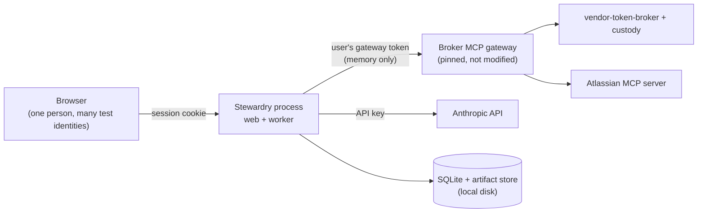

# Threat model

Status: updated for Milestone 1, step S1 (storage), 2026-10-10. Each milestone
step that adds behavior updates this file in the same pull request.

This document states what Stewardry protects, where its trust boundaries
are, and what it does **not** claim. It does not inherit any claim from
vendor-token-broker or any other project.

## Assets

| Asset | Why it matters |
|---|---|
| Users' gateway-scoped hub credentials | They let the gateway act as that user at Atlassian |
| Confidential synthetic policy passages and their provenance | Reviewer-only, and must not reach Sales views, exports, or status text |
| Approval records bound to answer revisions | They decide what is released to Sales |
| The audit log and its anchors | Evidence for every control claim |
| The Anthropic API key and the hub client secret | They spend money and identify the application |
| Customer scope of tasks, drafts, and library entries | Cross-customer leakage is a zero-tolerance failure |

## Trust boundaries

1. **Browser → Stewardry.** Only an opaque session cookie crosses this
   boundary. Hub tokens never reach the browser (ADR 0005).
2. **Stewardry → gateway.** Stewardry holds the user's gateway token in
   memory and nowhere else. It never holds vendor tokens and never calls the
   broker directly (ADR 0006).
3. **Stewardry → Anthropic.** The model receives only permitted passages,
   never credentials, MCP tools, or other users' data (ADR 0003).
4. **Stewardry → local disk.** A local administrator controls the database,
   the anchors, and the code (ADR 0004).

## Main threats and planned controls

| Threat | Planned control | Lands in |
|---|---|---|
| Prompt injection in questionnaires or NDAs | Text treated as data; authorization checked on every call; the model cannot approve; screening only supplements | S5, S9, S11, Milestone 2 |
| Wrong acting user or identity swap | Task grants bound to the authenticated `sub`; no fallback identity | S4, S5 |
| Over-broad Atlassian reads (`executeRead`, `discover`) | Per-agent policy and platform baseline denies in Stewardry | S3, S5, S7 (ADR 0009) |
| An outage shown as missing consent | Consent only from structured elicitation; unknown errors fail closed | S7, S14b (ADR 0010) |
| Credential leakage into logs, prompts, audit, or artifacts | Redaction filter, secret-shape scan, and no-token tests | S0 (repo scan), S2, S6, S14b |
| Local data exposure or accidental commit | Data directory outside any git work tree; directory 0700, and database and artifact files 0600 | S1 |
| Silent artifact corruption or substitution | Artifacts stored by SHA-256 and re-hashed on every read | S1 |
| Invalid rows written by a code bug (an unknown status, a revoked grant with no reason, missing usage recorded as zero) | Database CHECK, foreign-key, and unique constraints, tested directly | S1 |
| Audit tampering | Append-only triggers, hash chain, anchors | S2 |
| Runaway cost | Per-run and daily budgets enforced in the model boundary | S6 |
| Supply-chain compromise | Hash-locked dependencies, 14-day cooldown, SHA-pinned actions, digest-pinned images, pip-audit, CodeQL, zizmor, actionlint | S0 |

## Inherited limitations (vendor-token-broker at `20d1426`)

These are the broker's documented limitations. Stewardry does not hide them:

- The gateway may trust a removed hub signing key for up to one hour.
- Issuer checks are partial: vendor discovery does not pin an expected
  issuer, and the hub callback does not reject a missing `iss`.
- Tool lists come from a checked-in snapshot. Live changes are logged, not
  adopted.
- The gateway has no per-client or per-agent policy (G3). Its errors are
  human-readable text (G4).
- The test hub and custody run in dev mode with in-memory storage (G1).
  Restarts disconnect every Atlassian account.

## Non-claims

- No claim of absolute audit immutability. A local administrator can
  rewrite both the chain and its anchors.
- No production or availability claims. Operation is local.
- No claim that screening prevents prompt injection.
- Zero observed failures in evals do not establish universal safety.
