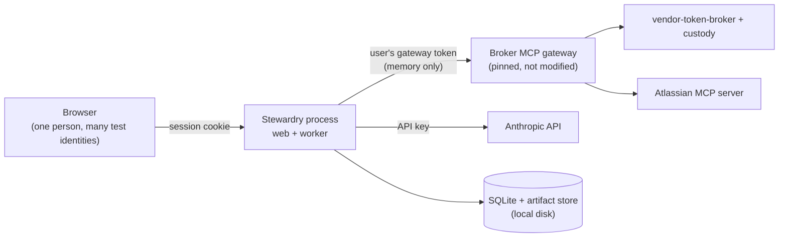

# Threat model

Status: updated for Milestone 1, step S13 (baseline evals), 2026-10-11. Each milestone
step that adds behavior updates this file in the same pull request.

This document states what Stewardry protects, where its trust boundaries
are, and what it does **not** claim. It does not inherit any claim from
vendor-token-broker or any other project.

## Assets

| Asset | Why it matters |
|---|---|
| Users' gateway-scoped hub credentials | They let the gateway act as that user at Atlassian |
| Confidential synthetic policy passages and their provenance | Reviewer-only, and must not reach Sales views, exports, or status text |
| Approval records bound to answer revisions | They decide what is released to Sales |
| The audit log and its anchors | Evidence for every control claim |
| The Anthropic API key and the hub client secret | They spend money and identify the application |
| Customer scope of tasks, drafts, and library entries | Cross-customer leakage is a zero-tolerance failure |

## Trust boundaries

1. **Browser → Stewardry.** Only an opaque session cookie crosses this
   boundary. Hub tokens never reach the browser (ADR 0005).
2. **Stewardry → gateway.** Stewardry holds the user's gateway token in
   memory and nowhere else. It never holds vendor tokens and never calls the
   broker directly (ADR 0006).
3. **Stewardry → Anthropic.** The model receives only permitted passages,
   never credentials, MCP tools, or other users' data (ADR 0003).
4. **Stewardry → local disk.** A local administrator controls the database,
   the anchors, and the code (ADR 0004).

## Main threats and planned controls

| Threat | Planned control | Lands in |
|---|---|---|
| A tool call that escapes the run's scope (another user, customer, page, or a raw MCP tool) | Every call goes through `Executor.call`. Identity, agent, customer, and stage come only from the run record. Arguments are schema-checked and may not name users, agents, customers, or credentials. Unknown tools are refused. Operations must be allowed by the baseline, the run's bound version, and the agent's current version, and stay within projects, spaces, and the catalog. Every decision is audited with the bound policy hash | S5 |
| Runaway or injection-driven tool loops | A tool-call budget per run (the stricter of the bound and current versions), per-operation limits, and a cap of 20 refused calls per run, after which the run fails | S5 |
| Prompt injection in questionnaires or NDAs | Text treated as data; authorization checked on every call; the model cannot approve. Only visible text in the template's question cells becomes a question. From S9, hidden rows, columns, sheets, and text, comments, tracked changes, text outside the template, and instruction-like phrases are recorded as screening findings for reviewers, with counts per kind audited. Screening is a heuristic and only supplements authorization | S5, S9, S11, Milestone 2 |
| A malicious upload (macros, external links, XML entity tricks, zip bombs, formulas) | Only `.xlsx` and `.docx` in the published templates. Macro-enabled and legacy formats, macro parts, and external links are refused. Size, part-count, expanded-size, and compression-ratio limits are checked before parsing. XML is parsed with defusedxml. Formulas in question cells are refused. Only the requester can upload, once, before drafting; refusals are audited | S9 |
| Wrong acting user or identity swap | Task grants bound to the authorizing subject. The acting identity comes only from the active grant, never from task fields. A missing credential, an expired or revoked grant, a paused agent, or a lost customer assignment pauses the task with no fallback. Mutation-tested in S4a | S4a, S4b, S5 |
| Cross-customer access | Customer assignments in the access mapping, checked at submission, at authorization, and again when a run acquires its identity | S4a, S5 |
| Self-authorization (one person acting as both requester and reviewer) | The requester cannot authorize their own task, even if they hold a drafting role | S4a |
| Changed hub subject reusing a known username | Sign-in is refused until a platform engineer re-maps it with an explicit flag. The old row keeps its history | S4a |
| Over-broad Atlassian reads (`executeRead`, `discover`) | Per-agent policy and platform baseline denies in Stewardry. From S3, applying a policy that names anything outside the baseline is refused and audited; runtime enforcement on every call lands in S5 and S7 | S3, S5, S7 (ADR 0009) |
| An agent keeps running after it is paused or retired, or a model or tool change skips evaluation | Registry lifecycle: `check_runnable` refuses unregistered, discovery-stage, paused, and retired agents, and is called at every controlled boundary from S5. A change to model, operations, or model tools requires an accepted eval before shadow or later | S3, S5 |
| Forged or replayed sign-in | OIDC authorization code with PKCE (S256), single-use state tied to the browser by a short-lived cookie, a nonce, and ID-token checks: signature (PS256/ES256 only), issuer, audience, `azp`, expiry. Callback replays and cross-browser callbacks are refused and audited | S4b |
| Cross-site request forgery on state-changing forms | A per-session CSRF token compared in constant time, plus an `Origin` check. Cookies are HttpOnly and SameSite=Lax, and Secure under HTTPS | S4b |
| Hub group claims used for authority | Ignored: authority comes only from Stewardry's access mapping (ADR 0008). Tested with `groups: [grc, platform_engineer]` on a Sales user | S4b |
| Hub tokens reaching the browser, pages, or logs | Tokens are held in server memory only. The browser holds an opaque session ID. Pages are `no-store`, with `Referrer-Policy: no-referrer` and a CSP without scripts. A test scans pages and the audit log for token values | S4b |
| Unauthorized registry or lifecycle change | Role checks against Stewardry's role mapping (platform engineer and engagement owner); refusals are audited as `denied` | S3 |
| An outage shown as missing consent | Consent only from a structured elicitation under the broker's authorize path, never from text. The 10 pinned gateway error templates are cataloged and checked against the pinned source. Unmatched errors fail closed (vendor error: the operation is refused; malformed: retry, then pause). Implemented and tested offline in S7; against the stand-in stack in S14b | S7, S14b (ADR 0010) |
| A consent link shown to the wrong person, or to an attacker-controlled host | Links are accepted only under the configured broker authorize path, returned only to the user's own interactive "Connect Atlassian" action, and never kept from a background run | S7 |
| Data beyond the allow-list reaching Stewardry (extra Jira fields, pages outside the catalog) | The adapter filters results to allow-listed Jira fields and catalog pages before anyone else sees them | S7 |
| Drift between Stewardry and the pinned broker | Unmodified vendored copies of the gateway source, the tool snapshot, and the allow-list are hash-checked offline and against the pinned commit in CI. Contract tests compare the error catalog and every sent argument with them | S7 |
| Credential leakage into logs, prompts, audit, or artifacts | One shared list of secret patterns: the repo scan (S0), redaction of audit events and `stewardry` log records (S2), plus no-token tests | S0, S2, S6, S14b |
| Local data exposure or accidental commit | Data directory outside any git work tree; directory 0700, and database and artifact files 0600 | S1 |
| Stale, superseded, conflicting, or changed evidence supporting an approved answer | Each page read is snapshotted with a SHA-256 of the body, the policy metadata, and numbered passages. A changed hash or changed metadata invalidates earlier snapshots (audited). Superseded or overdue policies, ineligible or invalidated snapshots, missing passages, and recorded conflicts all give insufficient/conflicting/stale support, which cannot be approved. The rules can only lower the drafting stage's claimed strength. `revalidate` is provided now; calling it before an approved file is returned lands with export | S10, Milestone 3 |
| Incomplete pages or unresolved macros used as evidence | Only a plain page layout is accepted; a missing body, any other element (Confluence `ac:` macros, macro wrappers, scripts), missing metadata, or no numbered passages make the snapshot ineligible | S10 |
| Evidence one user read reaching another user or customer | Snapshots are keyed by run, acting user, task, customer, page, and version, all from the run's protected context, and every lookup filters on all of them. Tested with forged run contexts | S10 |
| A drafted answer reaching review without real support (invented or unread citations, overclaimed strength) | Citations must name passages the run actually read, in eligible snapshots. The strength rubric can only lower the model's claim. Only a cited answer with direct current support is `ready_for_review`, and a database CHECK enforces that. Everything else, including refusals, answers without an outcome, and a used-up per-question budget, needs an expert | S11 |
| The model approving, releasing, or acting as someone else | The model has only four tools, none of which approve or release. Unknown tools and arguments that name users are refused and audited. The model is told only that an item was recorded | S11 |
| Duplicate or lost drafts after a crash | One leased job per question with an idempotency key, at most 3 attempts. One outcome per question (primary key). A restart resumes in a new run. A pause puts the question back in the queue | S11 |
| Simulated model output mistaken for evidence | Transports have a kind. A scripted test double can only serve `scripted-example` runs | S11 |
| Reviewer-only content reaching Sales (answers, passages, policy names, strengths, expert reasons, screening excerpts, reviewer names, links) | Each page gets a server-side view model built for its role. The Sales model holds only the request, plain status text, and counts. Leak tests compare the Sales HTML with everything drafting stored | S12 |
| Someone opening a page meant for another role or person | Task pages are for the requester only (404 for anyone else). Review is for a GRC reviewer assigned to the customer who did not request the task. The registry is for platform engineers, engagement owners, and auditors. Refusals are audited (`view.denied`); successful review views are audited too | S12 |
| A confidential passage shown to a reviewer who could not read it | Passage text from a confidential policy is shown only to the reviewer whose own access read it; other reviewers see the citation without the text. This is Stewardry's rule. Per-page Confluence permissions for other viewers are not rechecked when the page is viewed (S15 verifies vendor-side denials) | S12, S15 |
| A shadow verdict taken as approval | Verdicts (agree, edit, reject) are stored for comparison only. They change no draft and release nothing, and the page says so. A repeated form submission is a no-op | S12 |
| A known policy conflict missed in another task | Conflicts are recorded per policy passage (`evidence_conflicts`) and apply to every task. Any answer citing a conflicting passage needs an expert. The shared note names only policy IDs and passages, never model or customer text. A document can therefore make other tasks more cautious, but cannot add customer text to them or approve anything. Found by the 2026-10-11 live baseline (evals/reports/README.md) | S13 |
| Overstated or mislabeled eval results | Each report carries exactly one provenance label (the generator refuses others) and the model, prompt, dataset, policy, control, and code versions. Raw and valid completion are separate. Zero-tolerance counts include failed runs. Rates under 20 items are labeled insufficient. Correctness stays "not graded" without author grades. Replay reports spend nothing and show no latency | S13 |
| Silent artifact corruption or substitution | Artifacts stored by SHA-256 and re-hashed on every read | S1 |
| Invalid rows written by a code bug (an unknown status, a revoked grant with no reason, missing usage recorded as zero) | Database CHECK, foreign-key, and unique constraints, tested directly | S1 |
| Audit tampering | Append-only triggers, an insert trigger that only accepts the next link, a hash chain, and anchors. `stewardry audit verify` detects edits, deletions, reordering, and insertions; truncation and full rewrites are detected only against an anchor | S2 |
| Runaway cost | Enforced in the model boundary before each call: model calls and USD per run (the stricter of the bound and current versions) and USD per UTC day. Retries are bounded (3 attempts). A response without usage stops the run, because its cost cannot be bounded | S6 |
| A replay mistaken for live evidence, or a live call made during replay | The transport must match the run's provenance. Replay serves recordings only, and a missing recording fails the run. The replay guard refuses to start while credentials are configured (environment variables, or `ant` profile credentials stored on disk, counted but never read) and blocks the network | S6 |
| A model or prompt change slipping into a running run | Model settings come from the run's bound version. A different current version stops the run | S6 |
| Supply-chain compromise | Hash-locked dependencies, 14-day cooldown, SHA-pinned actions, digest-pinned images, pip-audit, CodeQL, zizmor, actionlint | S0 |

## Audit integrity: trust boundary and recovery

- The database triggers stop accidental or casual changes. Anyone who
  controls the SQLite file can drop them. The hash chain then shows edited,
  deleted, reordered, or inserted events.
- Someone who removes the newest events, or recomputes the whole chain,
  can be detected only by comparing against an anchor taken earlier.
  Anchors in the data directory are under the same control as the database.
  Copy the anchor file somewhere else, for example with each dated session
  record, after running `stewardry audit anchor`.
- **If `stewardry audit verify` fails:**
  1. Stop connected sessions.
  2. Keep copies of the database, its WAL file, and every anchor file
     exactly as found.
  3. Record the verify output, the date, and the operator.
  4. Restore the last copy that verifies against an anchor held outside the
     data directory, and record what was lost.
  5. Treat any results that rely on the affected window as unverified.

## Inherited limitations (vendor-token-broker at `20d1426`)

These are the broker's documented limitations. Stewardry does not hide them:

- The gateway may trust a removed hub signing key for up to one hour.
- Issuer checks are partial: vendor discovery does not pin an expected
  issuer, and the hub callback does not reject a missing `iss`.
- Tool lists come from a checked-in snapshot. Live changes are logged, not
  adopted.
- The gateway has no per-client or per-agent policy (G3). Its errors are
  human-readable text (G4).
- The test hub and custody run in dev mode with in-memory storage (G1).
  Restarts disconnect every Atlassian account.

## Known limitation: CLI identity

The web app authenticates people through the hub (S4b). The administrative
CLI does not: `stewardry registry` and `stewardry roles` take `--as `,
which is **asserted by the operator**. It is checked against Stewardry's role
mapping and recorded in the audit log, but anyone with shell access to the
data directory could assert any subject. Registry and access-mapping changes
made through the CLI are therefore attributed, not authenticated. Anyone
with that shell access also controls the database file itself (see "Audit
integrity"). Moving these operations into the authenticated web app is
backlog work, not Milestone 1.

## Non-claims

- No claim of absolute audit immutability. A local administrator can
  rewrite both the chain and its anchors.
- No production or availability claims. Operation is local.
- No claim that screening prevents prompt injection.
- Zero observed failures in evals do not establish universal safety.
