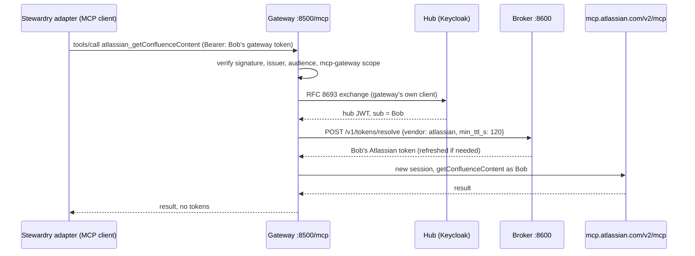

# vendor-token-broker contracts Stewardry must use

Reviewed revision: `chief-builder/vendor-token-broker@20d1426622a0c05478c4331b82ad8952411f9a4a`
(local clone at `../vendor-token-broker`; not modified).

Files read at that revision: `README.md`, `docs/api.md`,
`docs/mcp-integration.md`, `docs/mcp-gateway.md`, `docs/quickstart.md`,
`src/mcp_gateway/upstreams.json`, `.github/workflows/ci.yml`. To check the
details below, I also read `src/mcp_gateway/snapshots/atlassian.json` (tool
schemas), the `atlassian` entry in `registry.example.json`,
`tests/stack/keycloak/mcp-realm.json`, and the image and command lines of
`tests/stack/docker-compose.yml`.

This is a documentation and configuration review. It is not a source audit,
and none of the broker's test suites were run. No live account, stored
credential, or registration was inspected.

## 1. How Stewardry obtains gateway-scoped user credentials

The broker separates three credentials (`docs/mcp-integration.md`, "Three
authorization boundaries"). Stewardry handles only the first one.

| Boundary | Credential | Who holds it |
|---|---|---|
| Client → gateway | Hub access token whose audience is the gateway (`{GATEWAY_PUBLIC_URL}/mcp`), with the `mcp-gateway` scope | **Stewardry**, per user, server-side only |
| Gateway → broker | Internal hub JWT from token exchange: one `mcp://tier/*` audience, an `mcp_contract` claim, PS256 or ES256 | Gateway only |
| Gateway → Atlassian MCP | Atlassian token resolved by the broker | Gateway, for one call |

**The supported hub flow** (`docs/mcp-gateway.md`, "Identity handoff"; realm
`tests/stack/keycloak/mcp-realm.json`):

1. Stewardry is registered as an OIDC client of the hub (realm `mcp`). It
   requests the `mcp-gateway` client scope, which adds the gateway audience
   (`http://localhost:8500/mcp` in the stack). Keycloak ignores the RFC 8707
   `resource` parameter, so the scope is what sets the audience.
2. The user signs in to Stewardry with the authorization-code flow and PKCE.
   The hub signs tokens with PS256. Access tokens live 300 seconds in the
   test realm (`accessTokenLifespan: 300`).
3. Stewardry keeps the access token, and the refresh token tied to the hub
   session, on the server. They are used only as the bearer credential to the
   gateway, for operations that the same user explicitly authorized.
4. The gateway checks the token (signature, issuer, audience, scope,
   algorithm). It then exchanges it at the hub, using its own confidential
   client `mcp-gateway` with `standard.token.exchange.enabled`, for a hub JWT
   with the same `sub`.

**What Stewardry must not do:** forward its token to the broker, call
`/v1/tokens/resolve`, or hold an exchanged hub JWT. The broker hands a token
to any caller that passes its internal authentication. Isolation therefore
depends on only the gateway being able to reach it (`docs/mcp-integration.md`,
"Calling the broker").

**Subject preservation:** the hub `sub` is the identity everywhere. The broker
rejects a `sub` that differs from the JWT (`400 sub-mismatch`). A consent link
opened by a different user fails (403). Alice and Bob stay distinct because
each brings their own token. No Stewardry field can choose another user's
credential.

## 2. How Stewardry's calls reach the Atlassian MCP server

- **Transport:** MCP streamable HTTP to `http://localhost:8500/mcp`. Tool
  names are `atlassian_<tool>`; the gateway strips the prefix. All upstreams
  use the `legacy` protocol (MCP 2025-11-25 handshake) toward Atlassian. The
  client-facing side supports 2025-11-25 and 2026-07-28.
- **One exchange and one fresh upstream session per call.** Nothing is
  cached, so each call adds latency (gateway known limitation). Stewardry's
  latency measurements must include this.
- **Consent:** if the user has not connected Atlassian, the gateway answers
  in one of two ways:
  - with a URL-mode elicitation, when the client advertises `elicitation.url`
    (as an `InputRequiredResult` on 2026-07-28, or `elicitation/create` on
    2025-11-25);
  - otherwise, with a tool error that contains the broker's `authorize_uri`.

  After the user accepts, the gateway polls `GET /v1/grants` every 2 seconds
  for up to `CONSENT_WAIT_S`. The consent itself runs in the user's own
  browser through the hub and then Atlassian. A binding cookie means the same
  browser must finish both steps.
- **Disconnect:** the gateway has a `disconnect_atlassian` tool.
  Stewardry does not expose it in iteration 1.
  Users disconnect through a supported client or the runbook.
- **Error semantics to preserve** (from the gateway's error table):

  | Gateway outcome | Stewardry state |
  |---|---|
  | Consent needed (elicitation, or an error with a link) | `needs_consent`: pause and show a connect prompt to that user only |
  | Declined, cancelled, or timeout | `needs_consent`: no retry loop |
  | Broker, hub, or upstream 5xx, unreachable, or slow | `unavailable`: bounded retry, **never** a connect prompt |
  | Hub refused the exchange, or broker 401 | `config_error`: alert the platform engineer |
  | `revoke-pending` | `unavailable_disconnect_pending`: no link |
  | Atlassian refused the token (401) | `needs_reconnect` |
  | The tool ran and reported an error (`is_error: true`) | `vendor_denied_or_not_found`: classified per operation (see G8) |
  | Gateway rejected Stewardry's own token (HTTP 401, `WWW-Authenticate`) | `needs_signin`: the user signs in to Stewardry again |

## Which read tools back each operation

These are the reviewed Atlassian tools (`upstreams.json` and the snapshot).
`cloudId` is required on every content call and comes only from
configuration. Every argument below is built by Stewardry. None comes from
the model.

| Spec 4.3.1 operation | Acting identity | Gateway tool | Fixed or allow-listed arguments | Stewardry-side filter |
|---|---|---|---|---|
| Confirm site and account mapping (setup and per-session check) | Each connected user | `atlassian_getAccessibleAtlassianResources`, `atlassian_atlassianUserInfo` | none | `cloudId` must equal the configured site. `accountId` must match the user's registered mapping and must differ from every other role's account |
| Read Jira request context at intake | Sales (requester) | `atlassian_getJiraIssue` | `issueIdOrKey` matching the allow-listed project key pattern; explicit `fields` list with `fieldsByKeys: true`; `responseContentFormat: markdown`; no `expand`, `properties`, or `includeEditableFields` | Keep only the allow-listed safe fields (for example summary, synthetic customer field, reporter). Drop everything else before storage |
| List policy or playbook pages and their versions | GRC (or Legal) | `atlassian_searchConfluence` | CQL built from a template: `type = page AND space = "<allow-listed key>"`, optional `id in (...)` from the catalog; `expand=version`; bounded `limit` | Keep the page ID, title, version number, and last-modified date for catalog pages. Ignore anything outside the catalog |
| Retrieve full published policy or playbook content | GRC (or Legal) | `atlassian_getConfluenceContent` | `content_id` from the catalog; `detail: "full"`; `content_format: "html"`; `draft` absent or false | Reject a body with unresolved macro wrappers or one that looks incomplete. Hash the content, split it into passages with stable locations, and store the evidence snapshot |
| Recheck before approval and artifact return | Authorizing reviewer | `atlassian_searchConfluence` (version) and `atlassian_getConfluenceContent` (hash) | Same as above | A version or hash change invalidates the affected evidence, drafts, and approvals |
| Show vendor-side denial | Sales | `atlassian_getConfluenceContent` on a restricted page | Catalog page ID | The expected outcome is a vendor denial or not-found. It is recorded as a blocked attempt, not a success |
| Jira search | n/a | `atlassian_searchJiraIssuesUsingJql` | **Not used in iteration 1.** Sales supplies the issue key | n/a |
| Generic reads and discovery | n/a | `atlassian_executeRead`, `atlassian_discover` | **Never called.** The adapter has no code path to them, and a test asserts it | n/a |
| Attachments, macro resolution, comments | n/a | Not on the allow-list (only through `executeRead`) | **Not available.** Questionnaires and NDAs are uploaded to Stewardry, and policies use plain content (as the spec already states) | n/a |
| Expert or owner updates to policies | SME, in Confluence's own UI | none | No Atlassian write from Stewardry | Stewardry detects the change on its next version check |

## Gaps the broker cannot meet as-is

These are flagged, not worked around. Each needs an owner decision or a
connected verification before connected access is claimed.

### Owner decisions (2026-10-10)

| Gap | Decision | Where it is designed |
|---|---|---|
| G1 | Keep the in-memory test setup for now. Record each stack recreate and each reconnect as an operational event. | ADR 0006, runbook |
| G2 | Add Stewardry's client and the other role users to the hub. | [ADR 0008](adr/0008-hub-roles-bootstrap.md) |
| G3 | Add per-agent policy in Stewardry, with a Stewardry-only gateway instance as later hardening. A gateway-side per-client policy is an upstream proposal only. | [ADR 0009](adr/0009-per-agent-policy.md), [proposals](proposals/broker-upstream-proposals.md) |
| G4 | Detect consent only from the structured elicitation. Classify other errors with a pinned template catalog, failing closed. A structured error code is an upstream proposal only. | [ADR 0010](adr/0010-gateway-error-classification.md) |
| G6 | Keep reviewer credentials in memory only, and pause drafting when they lapse. | ADR 0006 |
| G5, G7–G12 | Unchanged: application work or connected verification, as described below. | |

| ID | Gap | Why it matters to the spec | Options (owner decides) |
|---|---|---|---|
| **G1** | The "existing hub" at this revision is the **test stack**. Keycloak runs `start-dev --import-realm` with documented test passwords. Custody is OpenBao `server -dev` (in memory). The quickstart says storage is wiped when containers stop. | Every restart disconnects every Atlassian account. Two weeks of hypercare (spec section 9) and dated monitoring need either an unbroken stack or a persistent setup. Test passwords also weaken the "distinct identities" story. | (a) Keep the dev stack and record each reconnect as an operational event. (b) Run a persistent local stack from the pinned images using the broker's `deploy/` shapes: non-dev OpenBao with file storage and Keycloak with a persisted database. This is new local configuration in the Stewardry repo; the broker repo is unchanged. |
| **G2** | The realm has no Stewardry client and only two users (`alice`, `bob`). The realm file lives in the broker repo, which must not be modified. | Sign-in for Stewardry and the role mapping in spec section 4.3.2 need more hub users and a client. | (a) A Stewardry-owned realm overlay or bootstrap script that uses the Keycloak admin API to add the `stewardry` client and persona users. (b) Dynamic client registration for the client (the realm allows anonymous registration for `localhost` with the `mcp-gateway` and `offline_access` scopes) plus admin-created users. Either way, this reconfigures the identity realm (not the Atlassian registration) and needs explicit owner approval. |
| **G3** | The gateway has no per-client or per-agent policy. Any valid gateway token can call all eight Atlassian tools, including `executeRead` and `discover`, with any arguments. Gateway logs record `sub`, tool, and outcome, but no Stewardry agent, task, or correlation ID. | Argument allow-listing and agent identity can only be enforced in Stewardry. Gateway logs cannot be joined to Stewardry runs except by `sub` and time. | Accept it, and state that the boundary is "Stewardry adapter plus Atlassian's own permissions". Correlate by `sub` and timestamp, and document the limitation. A broker change (a gateway allow-list per client, or a correlation header) is out of scope here. |
| **G4** | MCP-side errors are human-readable text. There is no stable machine-readable code for needs-consent, unavailable, revoke-pending, or config error. The broker's problem titles are frozen, but the gateway's MCP error messages are not a documented contract. | Spec section 4.3 says outages must not look like missing consent. Classifying by message text is brittle. | (a) Pin the message shapes with contract tests against the pinned revision's stand-in stack, and fail closed: anything unknown becomes `unavailable`, never consent. (b) Ask for a structured error field upstream later. Owner choice. |
| **G5** | Consent is designed for interactive MCP clients that open the link themselves. Stewardry is a web app acting for the user. | Stewardry must relay the `authorize_uri` to the right user's browser without ever showing it to anyone else. | Application work, superseded in detail by ADR 0010: the client always advertises `elicitation.url`. Only an interactive "Connect Atlassian" action by that user relays the link. Background runs record `needs_consent` and pause. This is not a broker change. |
| **G6** | The broker offers no delegation for work that continues after sign-in. Hub access tokens live 300 seconds. Refresh needs a hub refresh token held by Stewardry. `offline_access` is allowed but long-lived. | Spec section 4.3.2 requires a documented renewal mechanism, task-grant lifetime, cancellation, and revocation, with no fallback identity. | Proposed: session-bound refresh token, held only in memory. Drafting pauses when the reviewer's hub session ends or Stewardry restarts. Alternative: `offline_access` stored encrypted and bound to the grant lifetime. Owner choice. |
| **G7** | The snapshot has no output schema for `getConfluenceContent`. It is unverified whether the response includes a page version number, and how complete `detail: "full"` HTML is. The tool description warns that document HTML can contain macro wrappers instead of visible content. | Spec sections 4.3.1 and 5.2 require page identity, returned version metadata where available, and a full body. | Verify in connected step S15. Use `searchConfluence` with `expand=version` as the version source if `getConfluenceContent` does not return one. The content hash stays the authoritative change detector either way. |
| **G8** | It is unknown how Atlassian's MCP server reports a page the user may not view (an error, a not-found, or an empty result). It is also unknown whether the gateway passes that through as `is_error: true`. | Spec section 4.3.1 requires showing vendor-side denial for Sales, separate from Stewardry's denial and from outages. | Verify in step S15 with a restricted page. Record the observed shape as a contract fixture. |
| **G9** | Rovo MCP must be enabled for the site, and an org admin must allow the broker's callback domain (`http://localhost:*`). Plan or usage limits on Rovo MCP, and whether it is available on the Confluence plan chosen for page restrictions, were not reviewed. | If any of these fail, connected access cannot work. | Check during setup verification ([setup-verification.md](setup-verification.md)). |
| **G10** | The Atlassian registration's redirect is bound to the broker's public URL used at registration time (`http://localhost:8600` per the quickstart). The stack uses fixed host ports and container names. | Stewardry's connected stack must keep the broker at that URL and must not run a second copy on the same Docker host. Changing it would need re-registration, which is forbidden. | Treat it as a fixed constraint. Stewardry's own ports must avoid the broker's ports (6390, 8180, 8210–8211, 8300–8330, 8500, 8600). |
| **G11** | For Atlassian, the broker records `vendor_user_id` as `unknown`. | The broker cannot show which Atlassian account a hub user connected. That is needed to prove distinct accounts (spec section 4.3.2). | Stewardry verifies the mapping with `atlassianUserInfo` per user and records it. This is a Stewardry check, not a broker feature. |
| **G12** | Inherited limits: the gateway trusts a hub signing key for up to one hour after it is removed; issuer checks are partial; tool lists come from a September 2026 snapshot (live changes are logged, not adopted). | These belong in Stewardry's THREAT_MODEL.md and known limitations, not hidden. | Document them. Add a contract test that pins the snapshot's Atlassian tool names and the argument fields Stewardry uses. |

## Implementation status (S7, 2026-10-10)

- **G4 is implemented as ADR 0010 describes**, in
  `src/stewardry/platform/atlassian/gateway_errors.py`. Consent comes only
  from a structured elicitation under the broker's authorize path. The 10
  gateway `ToolError` templates are cataloged, and a contract test compares
  them with the pinned `server.py` (vendored unmodified in
  `third_party/vendor-token-broker/`, checked by hash).
- **The adapter** (`src/stewardry/platform/atlassian/adapter.py`) sends only
  the five tools in the table above, with fixed or allow-listed arguments. A
  contract test checks every tool and argument against the pinned snapshot
  and allow-list. Another checks that no string in the code names
  `executeRead`, `discover`, Jira search, or a write tool.
- **Response shapes are assumptions until S15.** Jira is read as
  `{key, fields}`, search as `{results: [{content: {id, title, version}}]}`,
  and a page as `{id, title, version, body}`. They follow the snapshot's
  descriptions; the snapshot has no output schemas. An unrecognized shape
  fails the run instead of being guessed at. G7 (version metadata) and G8
  (the shape of a restricted-page denial) are still open, and are verified
  in the connected step S15.
- **Page listing is limited to the policy's catalog** as well as the space.
  `confluence.list_pages` now names the same catalog as
  `confluence.read_page`.

## Compatibility tests Stewardry will own

| Test | Tier |
|---|---|
| Adapter builds only allow-listed arguments; `executeRead` and `discover` are unreachable; token strings never appear in results, logs, audit, or prompts | offline |
| The snapshot's tool names and argument fields still match what the adapter sends | offline (reads the pinned snapshot) |
| Sign-in, gateway call, consent relay, decline, timeout, broker outage that is not consent, disconnect then needs-consent, Alice and Bob kept separate, no token material in Stewardry logs | stack (the broker's stand-in Atlassian, no real credentials) |
| Site and account mapping, Jira field read, full-page read with version and hash, restricted-page denial, change detection after a manual Confluence edit | connected (step S15) |
