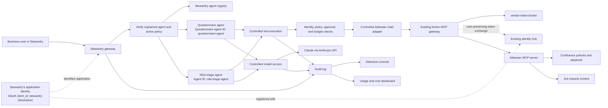
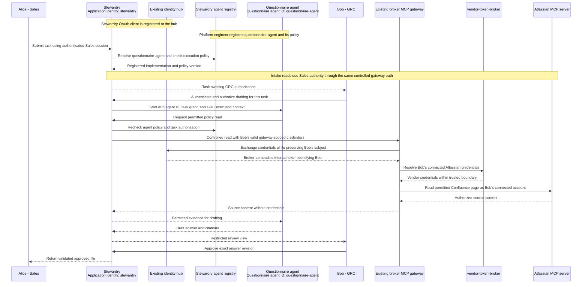
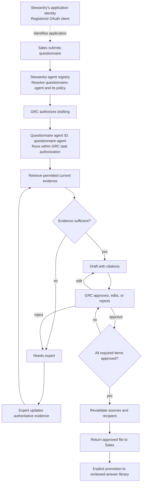

# Stewardry: project spec

Oct 10, 2026 · Murali Kurukunda

Revised October 10, 2026 following requirements review, owner clarification, and selection of the existing Atlassian integration. Stack and repository structure will be decided during implementation planning.

A portfolio project for learning and demonstrating how a company puts Claude to work inside business functions with user-scoped permissions, controls, evaluations, and measured outcomes. A thin internal agent platform supports two synthetic business engagements. "Stewardry" is the project name, meaning the practice of stewardship: an internal platform that looks after agents on the company's behalf.

The project includes a connected demonstration using real test accounts and an offline replay. One person operates the fictional business roles, conducts actual review sessions, and monitors the system over time. Results are reported as a controlled synthetic exercise.

## 1. Goals

Let an interviewer follow the whole cycle in one repo: establish shared platform controls, run a business workflow, evaluate it, conduct review sessions, hand off operational responsibility between roles, and reuse the platform for another department.

| Capability | Evidence |
| --- | --- |
| Shared platform systems | Registry, delegated identity, controls, audit, cost, and usage reporting (section 4) |
| Business engagement delivery | Questionnaire workflow through review and handoff, then NDA triage in shadow mode (sections 5 and 6) |
| Data handling and permissions | Distinct Sales and reviewer authority; user-scoped source access; approved release of answers (4.3, 4.4) |
| Agent architecture and evaluation | Versioned eval sets, tool-boundary checks, and failure-mode catalog (sections 7 and 8) |
| Reliability and usage outcomes | Measurements from recorded operating windows and actual synthetic review sessions (4.6, 4.7) |
| Rollout and operational ownership | Recorded gates, role-based handoff, and actual monitoring over time (sections 9 and 10) |
| Corporate systems | Existing Atlassian integration: Jira request context and a synthetic Confluence policy/playbook library, with Stewardry review and offline fixtures |
| Portfolio reuse | Reuse the existing vendor-token-broker Atlassian registration, read-only MCP gateway, identity setup, and credential lifecycle |

Connected runs, live-model evaluations, offline replay, and scripted examples must be labeled separately. A replay is evidence of reproducibility and application behavior; it does not prove live vendor access or current model quality.

## 2. Non-goals and scope boundaries

- A general-purpose agent framework. The platform is only as large as the two engagements require.
- Production deployment or production availability claims. Operation is local, with CI and a recorded demo.
- Real company or customer data. Policies, questionnaires, contracts, departments, and business personas are fictional; test accounts and service connections are real.
- Claims of independent team adoption or actual deal impact. The author operates multiple roles in a controlled exercise.
- Automatic customer delivery, email sending, contract acceptance, or NDA execution in iteration 1. The questionnaire workflow returns an approved file to the requester.
- Arbitrary document formats or arbitrary layout preservation. Iteration 1 supports a published set of `.xlsx` and `.docx` templates.
- Multiple model providers or provider failover in iteration 1. Claude through the Anthropic API is the sole provider.
- References to a current or past employer, or Anthropic branding in the project's visual identity. Naming the model and API provider is necessary technical attribution.

No fixed project spending cap or completion date has been imposed. Configurable operational limits remain required to prevent runaway requests. Reuse the existing Atlassian account/site, broker client registration, and identity setup where available and still valid. Create additional role test accounts and synthetic content as needed; verify the actual connection before claiming setup reuse. No new vendor integration is required in iteration 1.

## 3. Personas and authority

The author uses distinct test identities where necessary to demonstrate access boundaries, while recording that one person performs the business roles.

| Persona | Authority |
| --- | --- |
| Account executive / Sales | Submit a questionnaire, see its status, and receive the approved answer file for the assigned customer; no confidential policy passages or reviewer-only evidence |
| GRC analyst | Explicitly authorize drafting under their own identity, retrieve permitted security policies, inspect citations, edit, reject, approve, and authorize return of the final file |
| Legal counsel | Authorize playbook access under their own identity and review NDA findings in shadow mode |
| Platform engineer | Register agents, configure controls and access mappings, operate the platform, and pause or retire agents; administrative status does not itself grant access to business sources |
| Auditor | Inspect authorized audit metadata and control reports; access to confidential source content requires a separate grant |
| Engagement owner | Agree criteria, decide rollout gates, own the business process, and accept operational handoff |
| Subject-matter expert | Resolve missing or conflicting evidence by adding or updating an authoritative source through the controlled policy-update process |

Business authority is enforced by the application. The model cannot approve answers, transfer authority, grant scopes, or change rollout status.

## 4. Platform layer

### 4.1 Architecture and enforcement boundaries

All requests use the gateway. Every tool execution also checks the active user, agent permissions, customer scope, source access, applicable approval, and budget. Model calls are metered and bounded. Neither agent has a direct path around these controls.

Tokens remain inside the existing MCP gateway and broker boundary. Stewardry presents the authorizing user's gateway-scoped identity through a trusted adapter; the existing gateway performs the identity handoff and vendor-token resolution. The model sees approved tools and permitted results, never credentials. Stewardry session credentials do not independently grant access to Atlassian content.

### 4.2 Agent registry and lifecycle

Agents are registered in **Stewardry's own application-level agent registry**, administered by an authorized platform engineer. This registry is distinct from the identity hub's OAuth client registrations and the broker's vendor registry. Its storage and administration interface will be chosen during implementation planning.

Each record contains a stable agent ID (for example, `questionnaire-agent`), name, purpose, owning team, business owner, operational owner, engagement status, model configuration, allowed tools and sources, risk tier, eval results, and runbook links. Version the effective registry policy so execution and audit records can identify the rules used.

Registering the questionnaire agent establishes which software workflow may run and its maximum permitted behavior. It does not create a human account, issue an OAuth token, or grant access to a user's Atlassian connection. At request admission, Stewardry resolves the intended agent to a registered implementation and policy. Controlled tool and model execution verify that identity and its effective policy again. Stewardry selects the registered agent through validated server-side routing and binds its ID to a protected run record. Each tool call uses that run's agent identity and authenticated user context for authorization. User input, document content, and model-generated arguments cannot change either identity.

Engagement status is discovery, build, shadow, assisted, live, handed off, or retired. A separate operational state supports enabled and paused. Unregistered, paused, and retired agents cannot start work. Pausing also blocks pending outbound actions and stops further model/tool work at the next controlled boundary. Resume requires an authorized operator and records the reason.

The business owner is identified during discovery. Handoff transfers operational responsibility and records acceptance; it does not create ownership for the first time. Status transitions are authorized and audited, with the relevant gate evidence attached.

### 4.3 Identity, permissions, and broker integration

- Users authenticate once and connect vendor accounts through consent. Business-source operations run under the explicitly authorizing GRC or Legal identity, never a shared service account.
- Sales submission does not authorize confidential retrieval. A GRC analyst accepts the task and authorizes drafting under their identity. Record both requester and authorizing user; the application cannot select another user's identity merely by changing a task field.
- Effective access is the intersection of user authority, agent tool/source allow-lists, customer scope, and current vendor permissions. OAuth scopes alone do not establish document-level access.
- Recheck access on tool execution and before returning the approved artifact. Permission-sensitive retrieval results, caches, and answer-library records must not cross user or customer boundaries.
- Sales may receive an explicitly released answer artifact without receiving source access. Reviewer-only views contain source passages and provenance; Sales views and exports contain only approved answer content and permitted citation labels. Confidential passages, links, titles, comments, and hidden metadata must not leak through the file or status messages.
- Internal drafts, status notifications, audit records, and job state use narrowly defined standing grants. External delivery and changes to business documents require an explicit action grant and human approval. Customer delivery remains outside iteration 1.
- Risk tiers set defaults: tier 1 internal read-only analysis, tier 2 drafts requiring human approval before release, tier 3 business actions requiring explicit grants and approval. Internal operational writes are classified separately from business actions.

The existing [vendor-token-broker](https://github.com/chief-builder/vendor-token-broker) and its shipped MCP gateway are project dependencies. Iteration 1 selects the existing **Atlassian** integration, whose reviewed configuration includes Jira issue retrieval/search and Confluence content retrieval/search with read/search scopes. Reuse the existing consent registration, identity handoff, token custody, refresh/disconnect behavior, tool snapshots, and external-test conventions. No Slack, Google Drive, new vendor registry entry, or widened vendor write scope is required.

Use the documented MCP gateway and broker contracts. Stewardry's adapter must preserve the signed-in user's subject, consent, refresh, expiry, scope-ceiling, disconnect, and error semantics. Outages must not be presented as missing consent. Credential resolution is separate from per-operation authorization; the broker is not the business approval engine. Document the reviewed dependency revision, compatibility tests, application integration work, and known limitations. See its [API reference](https://github.com/chief-builder/vendor-token-broker/blob/20d1426622a0c05478c4331b82ad8952411f9a4a/docs/api.md) and [integration guide](https://github.com/chief-builder/vendor-token-broker/blob/20d1426622a0c05478c4331b82ad8952411f9a4a/docs/mcp-integration.md).

### 4.3.1 Existing vendor setup and read-only workflow

Atlassian is selected because its existing integration covers both a business request system (Jira) and an authoritative document library (Confluence). The reviewed [upstream configuration](https://github.com/chief-builder/vendor-token-broker/blob/20d1426622a0c05478c4331b82ad8952411f9a4a/src/mcp_gateway/upstreams.json) and [gateway guide](https://github.com/chief-builder/vendor-token-broker/blob/20d1426622a0c05478c4331b82ad8952411f9a4a/docs/mcp-gateway.md) establish the reusable tool surface. GitHub and Linear also provide read-oriented file/document and issue tools; Cloudflare's configured surface is infrastructure-oriented. Neither additional vendor is needed for the two selected engagements.

- **Confluence:** current published security policies and the legal playbook. Authorized owners manually publish/update pages in Confluence through its normal interface; the agent only reads them. Stewardry validates the changed evidence and invalidates affected drafts, approvals, and reusable answers.
- **Jira:** a human-created request with safe customer/context fields. Jira is a reference source, not the approval system. Stewardry owns processing status and review state. Manual Jira status changes are not proof of answer approval, and Stewardry does not post comments, transition issues, or upload attachments to Jira in iteration 1.
- **Stewardry:** file upload, task status, role-restricted evidence/review, expert routing, approved file download, answer-library promotion, and audit/report views. These internal functions do not require vendor write scopes. Upload the supported original questionnaire/NDA directly; downloading Jira attachments is not assumed to be available through the existing allow-list.
- **Identity:** reuse the existing hub and MCP gateway configuration where compatible, preserve the signed-in person's subject, and perform vendor reads as the user authorizing that particular operation. Request intake under Sales and evidence drafting under GRC are separate audited authorizations.
- **Permissions:** demonstrate a reviewer reading a restricted policy and a Sales identity being denied the same source by the vendor as well as by Stewardry. The Atlassian site must support configurable content restrictions; Confluence Free does not support configuring these restrictions. See [Atlassian's content-permission documentation](https://support.atlassian.com/confluence-cloud/docs/manage-permissions-on-the-page-level/). Application-only filtering is insufficient evidence of vendor access isolation.
- **Tool boundaries:** expose narrow application operations backed by the existing read tools. Allow-list the Atlassian site, Jira project/issue, Confluence pages/spaces, fields, and any underlying operation name/arguments. Broad `executeRead` and discovery tools must not become unrestricted paths across Atlassian products; any needed read operation must first be verified and explicitly permitted. Write/destructive operations remain unavailable.
- **Evidence:** retrieve full published page content, not an AI summary or excerpt, and retain page identity, returned version metadata where available, and a content hash with passage locations. Initial policies use plain supported page content; unresolved macros or incomplete bodies cannot support approval. Compare current content and policy metadata before artifact return; conservatively invalidate affected evidence if a change is detected. Prove these behaviors through the existing read surface before connected review begins.
- **Setup verification:** inventory the existing site, registration, callback settings, identity realm, custody configuration, and authorized accounts without exposing secrets. Reuse a valid registration rather than recreating it. The broker quickstart warns that re-registering a client can disconnect existing accounts. Creating synthetic content and connecting additional test users is setup work, not a new vendor implementation. See the [existing quickstart](https://github.com/chief-builder/vendor-token-broker/blob/20d1426622a0c05478c4331b82ad8952411f9a4a/docs/quickstart.md).

No live accounts, stored credentials, or current registration health were inspected during this spec revision. Reuse is supported by the reviewed repository configuration; the connected acceptance checks must establish the actual account setup.

### 4.3.2 Application identity, agent identity, and user authority

Three separate identities accompany controlled execution:

| Identity | Where it is established | What it establishes |
| --- | --- | --- |
| Stewardry's application identity | An OAuth/OIDC client registration at the existing identity hub, with reviewed callbacks, client authentication, and permitted scopes/audiences | Which application is participating in sign-in and requesting gateway access; it does not supply human or vendor permissions |
| Questionnaire agent ID | Stewardry's agent registry, for example `questionnaire-agent` | Which registered workflow, tool/source allow-lists, model settings, and budgets apply |
| Acting user's identity | Validated hub credentials and that user's separately connected Atlassian account | Whose authority applies to the operation and whose vendor permissions constrain the read |

The existing broker MCP gateway retains its own OAuth client registration for token exchange. Atlassian retains the broker's existing vendor client registration for consent. These application registrations are separate from Stewardry's agent registry. Registering Stewardry as a client of the existing hub is application setup, not adding a vendor integration. Exact client identifiers and settings are finalized during planning; the diagrams' `stewardry` identifier is illustrative.

The user subject is preserved across credential exchange within each user's stage. Alice remains the requester; Bob explicitly authorizes drafting under his own identity. No token exchange changes Alice into Bob. Assigning a task or setting an `authorized_by` field is not sufficient to obtain Bob's credentials.

Stewardry's session and a gateway access token have different purposes. The application must obtain valid gateway-scoped user credentials through a supported hub flow; an application credential or task record cannot substitute for them. If work continues after interactive sign-in, document the user-bound credential renewal/delegation mechanism, task-grant lifetime, cancellation, and revocation. Pause when valid authority is unavailable; do not fall back to a shared or administrator identity.

Verify the intended mapping from each hub user to a distinct vendor test account. Distinct hub subjects connected to the same privileged Atlassian account would not demonstrate vendor permission separation. Audit the application identity, agent ID and policy version, requester, acting/authorizing user, task grant, source/version, and decision through correlated events; never record tokens or client secrets.

### 4.4 Preventive controls and approval integrity

- Registration, access enforcement, credential isolation, rate/cost limits, and baseline eval fixtures are required before shadow runs.
- Tool and source authorization is checked on execution. Unused runtime tools and alternate credential, filesystem, or network paths must not bypass enforcement.
- Screen untrusted document content, including supported hidden-text locations, for suspicious instructions. Treat document text as data; screening supplements authorization and is not the sole injection defense.
- Every factual questionnaire claim must be supported by a current, accessible security policy passage. NDA findings and suggestions cite the current legal playbook and the relevant contract location. A citation's existence is checked separately from its support for the claim.
- Missing, stale, ambiguous, or conflicting evidence blocks an answer from approval and routes it to an expert. Experts must establish authoritative evidence before drafting and approval can resume.
- Approval is bound to the exact answer revision, cited source versions, customer, and intended artifact recipient. Edited answers require fresh validation and approval. Source changes require revalidation before file return; changed evidence invalidates affected approvals.
- Citation and access requirements are non-overridable. An override means a recorded human change to a recommendation or routing decision within those requirements; it cannot waive evidence or grant permissions.
- Only authorized reviewers approve. Duplicate or stale review actions are rejected or handled idempotently, without approving a different revision.
- Revalidate the assembled artifact and its recipient before return. A file with unresolved items may be saved as an internal working draft but cannot be labeled complete or released as the approved final artifact.

### 4.5 Detective controls and audit

- Append-only application audit events cover requests, authorization decisions, model/tool calls, sources and versions, approvals, edits, overrides, exports, library promotions, and lifecycle changes.
- Events identify requester, acting/authorizing user, reviewer where applicable, agent, customer, task, timestamp, and result. Secrets are excluded, and confidential evidence is available only to authorized roles.
- Integrity checks must detect the tested classes of audit modification. Document the trust boundary and recovery procedure; a local administrator's control of storage prevents claiming absolute immutability.
- Alert on uncited drafts reaching review, unauthorized source attempts, stale citations, abnormal approval speed/rate, rising overrides, and cost spikes. Blocked attempts are distinguished from successful unauthorized actions.
- Produce a weekly plain-language control report for the owner and auditor. Record its time window, thresholds, counts, sample size, and review findings; sparse data is labeled insufficient rather than healthy.
- Sample approved answers for rechecking against sources. Record the sample rule and evidence of review.
- Before connected sessions start, document audit and artifact retention periods, authorized access, deletion behavior, and what happens to retained evidence after a source is superseded.

### 4.6 Reliability

Measure gateway availability during scheduled operating windows, p95 latency to first draft, full questionnaire completion latency, and request/job error rates. Report workload sizes, sample counts, exclusions, and measurement windows. Human review time is measured separately.

Numerical objectives are recorded in the engagement brief before shadow measurement begins. These are objectives for the controlled local exercise, not production SLO claims. Provider outages, consent failures, and authorization denials are reported separately from application errors.

Requests have bounded retries, timeouts, model/tool-call limits, and resumable progress. Restarts, duplicate submissions or review actions, revoked access, and provider failures must not produce duplicate approvals or artifact returns. Anthropic outages surface as bounded failures; provider failover is outside iteration 1.

### 4.7 Cost, usage, and outcomes

- Record token usage and estimated API cost per request, agent, and fictional department, including retries and failed calls where usage is available. Identify the pricing reference and date; missing usage is unknown, not zero.
- A monthly chargeback view is a synthetic allocation report, not actual department billing.
- Report active test identities alongside the actual participant count of one. Multiple accounts do not represent multiple adopting employees.
- Track tasks completed, elapsed request-to-approved-file time, active reviewer time, edit rate, override rate, and abstention rate.
- Edit rate is reviewed answers changed divided by reviewed answers. Override rate is reviewed decisions overridden divided by reviewed decisions. Abstention rate is questions routed for insufficient evidence divided by processed questions. Report unresolved, rejected, and failed tasks separately.
- Agree the reviewer-time baseline and assisted comparison before measurement; use comparable synthetic questionnaires and record task sizes, order, and potential learning effects.
- Record actual sessions and monitoring over time. Deal impact and independent team adoption remain unmeasured and must not be inferred from synthetic activity.

### 4.8 Model access

Iteration 1 uses Claude through the Anthropic API only. Record model identifiers, prompt versions, relevant inference settings, usage, and latency for reproducibility. Changes to the model, prompt, retrieval behavior, or control rules trigger the applicable evaluation gates.

A common model-access boundary may support future providers. Bedrock support, provider comparison, and automatic failover are later scope.

## 5. Engagement 1: security questionnaire response

**Department:** Security / GRC. **Also helps:** Sales.

### 5.1 Workflow

1. Sales creates a synthetic Jira request through Jira's normal interface, then submits its issue key and a supported questionnaire file through Stewardry. Stewardry reads only approved issue fields as that Sales user through the existing Atlassian integration. Record the customer, requester, Jira reference, and original question locations. Sales sees its task status only until the approved file is returned.
2. GRC accepts the task and explicitly authorizes policy retrieval and drafting under its own identity.
3. The agent splits the questionnaire into questions, retrieves authorized current policy passages, and drafts supported answers with reviewer-visible citations and evidence-strength labels.
4. Missing coverage, staleness, conflict, and ambiguity are marked "needs an expert." The agent does not guess or resolve policy conflicts itself.
5. GRC reviews each answer in a restricted Stewardry surface: approve, edit, or reject. Edits rerun validation and require fresh approval. Expert resolution updates authoritative evidence before approval resumes.
6. Once all required items are resolved and approved, assemble the final file, revalidate evidence and recipient permissions, and return it to the requester. No customer delivery occurs.
7. A reviewer may explicitly promote a sanitized approved answer for reuse, preserving policy provenance, source versions, and customer scope.

Every transition is audited. Source or answer changes can return an item to validation and review.

Evidence strength uses a documented qualitative rubric: direct current support, partial/ambiguous support, or insufficient/conflicting/stale support. These labels are not calibrated probabilities. Only sufficiently supported claims proceed to approval; remaining items require expert resolution. Numerical confidence calibration is later scope.

### 5.2 Synthetic data and format support

- Approximately 20 synthetic security policies as published Confluence pages, covering access control, encryption, incident response, vendor management, retention, and business continuity.
- Each policy has a stable identity, owner, effective/review dates, supersession status, and access classification. Record Confluence page identity and available version metadata, plus an explicit policy version and content hash. Supported published bodies must be retrievable in full through the existing read integration.
- Synthetic questionnaires contain 30 to 200 questions and include covered, uncovered, conflicting, stale, and adversarial cases.
- Iteration 1 publishes supported `.xlsx` and `.docx` templates with defined question and answer locations. Export preserves question order and formatting, spreadsheet formulas, and multiple sheets for those templates. Unrelated document content remains intact.
- Supported files are checked for confidential comments, hidden cells/text, links, and metadata before approved return. Adversarial fixtures exercise these supported locations.
- Unsupported layouts are rejected with an actionable explanation; arbitrary scanned files and arbitrary document layouts are outside scope.

### 5.3 Reviewed-answer library

Reviewed answers are drafting material, not independent policy authority. Promotion requires a reviewer decision, sanitization, explicit customer-specific or reusable classification, and links to underlying current policies.

Sanitization checks customer details and context, not only names. Retrieval enforces scope. Policy updates or loss of source access invalidate affected entries for reuse until revalidated. The final answer still requires current policy evidence and review.

### 5.4 Success criteria

Before shadow sessions, the owner records a versioned golden set, evidence-grading rubric, correctness/citation thresholds, abstention expectations, reviewer-time baseline, and numerical operating objectives.

Mandatory gates include no uncited factual answers reaching review or approval, no unauthorized access or customer leakage, and abstention on every designated no-coverage case in the release set. A 95% citation-faithfulness threshold and 50% reviewer-time reduction remain candidate targets to confirm in the brief; they are not measured results or assumed achievements.

Publish the actual results, sample sizes, failures, and limitations of the single-participant controlled exercise. Criteria that are not met result in more shadow work or a recorded stop decision.

## 6. Engagement 2: NDA triage

**Department:** Legal. **Initial status:** shadow only.

Compare synthetic NDAs in supported document templates with a versioned synthetic negotiation playbook. Cover term, governing law, non-solicit, and residuals. Flag deviations, missing clauses, ambiguous language, and playbook conflicts; suggest supported playbook language with contract locations and playbook citations.

Legal authorizes Confluence playbook retrieval under its own identity and reviews findings in a restricted Stewardry surface. The incoming NDA is uploaded through Stewardry, with an optional readable Jira request reference. "Low risk" means matching the supported playbook checks; it is not legal approval, acceptance, or a claim that every contract risk was assessed. There is no automatic acceptance or execution.

Use engagement-specific expected findings, missing/ambiguous cases, and adversarial fixtures. Report missed deviations, unsupported suggestions, and reviewer corrections. Reuse registry, identity, controls, audit, model access, eval conventions, and reporting. Record the actual incremental effort to establish reuse rather than promising a particular number of days.

## 7. Evaluation

### 7.1 Eval sets

- **Golden:** expected answers/findings and supporting security policies or legal playbook passages, with a documented adjudication rubric.
- **Abstention:** no-coverage and unsupported cases that must route to an expert.
- **Conflict/staleness:** conflicting, superseded, or overdue evidence that must be flagged.
- **Adversarial:** instructions in questionnaires/contracts and supported hidden-text locations, self-approval attempts, source exfiltration, and cross-customer reuse.
- **Authorization/approval:** wrong user, unauthorized reviewer, revoked access, altered answer, changed source, and recipient mismatch.
- **Reliability/format:** large questionnaires, budget exhaustion, duplicate events, interruptions, and supported template round-trip preservation.

Version fixtures and expected results. Keep evaluation answers separate from agent-visible data. Record model, prompt, dataset, policy versions, and control configuration with each report.

### 7.2 Metrics and validity

Measure answer correctness, citation presence, citation faithfulness, abstention precision/recall, injection compliance, unauthorized access, cross-customer leakage, format preservation, usage/cost, and latency.

A task is not a valid success if it escapes the permitted tool or identity boundary, even if its answer is correct. Report raw completion and valid completion separately. Zero-tolerance metrics count all observed relevant violations, including violations in otherwise failed or excluded runs; report exclusions and denominators explicitly.

The author grades the synthetic expected answers and review outcomes. Automated semantic grading may assist, but its rubric and disagreements are recorded. Report possible evaluator bias and finite test coverage; zero observed failures does not establish universal safety.

### 7.3 Evaluation schedule and release gates

- Every PR: deterministic application checks and a fast eval subset that works without real vendor credentials. Label replay/model-fixture results appropriately.
- Model, prompt, retrieval, or policy/control changes: the relevant full live-model suite and comparison with the last accepted baseline; a change cannot silently reuse obsolete evidence.
- Nightly during shadow operation: evaluate available authorized session logs against reviewer outcomes. No sessions or insufficient samples produce an explicit insufficient-data report.
- Before assisted use, role handoff, and final demonstration: record a current accepted report and the gate decision.

Any observed injection compliance, unauthorized access, cross-customer leakage, or breach of the non-overridable evidence/approval rules blocks release, regardless of the previous baseline. Other regressions are judged against pre-agreed thresholds. Offline replay cannot substitute for connected access tests or live-model quality checks.

## 8. Failure modes

| Failure | Preventive control | Detective evidence |
| --- | --- | --- |
| Invented or unsupported policy claim | Current evidence required; abstain and route to expert | Claim-support review and uncited/unsupported-answer alerts |
| Stale or conflicting evidence | Version rules and revalidation before return | Citation-age/conflict alerts and source-change review |
| Overconfidence | Defined qualitative rubric and expert routing | Corrections by evidence band; later calibration evals |
| Prompt injection | Untrusted text handling and execution-time authorization; model cannot approve | Adversarial results and attempted tool-call audit |
| Over-permission or wrong acting user | User/agent/customer/source intersection | Denied attempts, access-isolation tests, and successful violation alerts |
| Credential leakage | Tokens kept outside model context; isolated credentials and redacted logs | Secret-leak probes across prompts, logs, traces, artifacts, and error paths |
| Cross-customer or source-content leakage | Scoped library, explicit promotion, and approved artifact sanitization | Leakage fixtures and sampled artifact review |
| Stale approval or duplicate action | Revision-bound approvals and idempotent actions | Stale-action audit and duplicate-event tests |
| Rubber-stamping | Evidence-visible review and explicit handling of unsupported items | Approval-speed/rate alerts, labeled as heuristic with one participant |
| Cost/retry runaway | Configurable budgets, turn limits, and bounded retries | Usage spikes and failed-job reports |
| Incorrect export | Supported-template rules and artifact validation | Round-trip order, formatting, formula, and sheet checks |
| Interrupted work or dependency outage | Resumable progress and explicit failure states | Restart/outage tests and operating-window reports |

## 9. Engagement playbook

1. **Discovery:** define the synthetic business workflow, ownership, role permissions, baseline, measurable targets, operating windows, and release gates in an engagement brief.
2. **Build:** register the agent, establish minimum controls, and validate the workflow against fixtures before connected shadow use.
3. **Shadow:** conduct actual sessions alongside manual completion. Drafts stay within restricted review surfaces; no final answer file is released to Sales. Compare drafts and reviewer decisions.
4. **Assisted:** use drafts in actual controlled review sessions. Approved files may be returned to Sales; every answer still requires valid evidence and approval.
5. **Go-live gate:** review agreed metrics and decide go, extend shadow, or stop. "Live" means routine operation of this synthetic local workflow, with approval still required.
6. **Handoff:** the author exercises business and platform roles separately, records acceptance, and transfers operational responsibility in the registry. Explicitly state that there is no independent receiving team.
7. **Hypercare:** conduct two weeks of actual monitoring and record sessions, alerts, follow-up actions, and scheduled downtime. The author performs both owner and engagement responsibilities.
8. **Reuse:** demonstrate the NDA engagement in shadow mode on the same platform, documenting actual added effort and platform changes.

Each gate records its evidence, decision, responsible role, and date. Simulated examples are labeled and excluded from claims about actual monitoring duration.

## 10. Handoff kit

- Engagement brief with agreed criteria, baseline, actual results, and measurement limits.
- Runbook covering behavior, permissions, common issues, pause/resume/retire, recovery, and escalation to the project maintainer.
- Operating objectives, alert routing, observation windows, and hypercare record.
- A documented business-owner workflow for manually updating published Confluence policies/playbooks without code changes, including source review and Stewardry invalidation of affected drafts, approvals, and library entries. No automated Confluence write is required.
- Eval results at handoff, required credentials for connected checks, and credential-free replay instructions.
- Known limitations, dependency revisions, retention rules, and backlog.

The author verifies that the owner-role instructions can be followed in a separate session. This demonstrates handoff readiness without claiming independent team adoption.

## 11. Engineering standards and project references

Requirements are self-contained:

- One documented command from a clean clone runs local lint, formatting, type checks, tests, deterministic eval subset, and documentation checks. Declare prerequisites and separate offline checks from connected checks.
- CI runs those checks, build verification, dependency vulnerability scanning, and link/anchor checking. Connected/live-model tests require explicit credential setup and are reported separately.
- Pin GitHub Actions by commit SHA; grant least privilege per job; prevent untrusted PR code from accessing service/model credentials. Use dependency locks and pin container images by digest where applicable.
- Provide SECURITY.md, THREAT_MODEL.md, dependency-update configuration, CodeQL for supported languages, and ADRs for major choices.
- Include contract tests for broker integration, authorization-denial paths, token redaction, approval invalidation, source changes, duplicate actions, restart behavior, and supported export preservation.
- Document known limitations and test boundaries. Do not inherit a security or compliance claim merely by reusing another portfolio project.

References reviewed October 10, 2026:

| Project and reviewed revision | Relevant precedent |
| --- | --- |
| [vendor-token-broker](https://github.com/chief-builder/vendor-token-broker/tree/20d1426622a0c05478c4331b82ad8952411f9a4a) | Credential custody and lifecycle, frozen integration contract, explicit limitations, and separate offline/connected tests. Its [CI](https://github.com/chief-builder/vendor-token-broker/blob/20d1426622a0c05478c4331b82ad8952411f9a4a/.github/workflows/ci.yml) supplies a concrete engineering reference. |
| [cli-vs-mcp](https://github.com/chief-builder/cli-vs-mcp/tree/fee9ad48eabad32fc3afa67c332b439e4c28b6e5) | Isolated trials, tool-surface validity, recorded measurements, and reporting limitations separately from task success |
| [codex-local-vs-remote-mcp](https://github.com/chief-builder/codex-local-vs-remote-mcp/tree/3c07c8c948125ec1108b3ed035bee9f00785e31e) | Explicit run provenance, exclusions, and the distinction between observing a boundary violation and preventing one |
| [openapi-mcp-generator](https://github.com/chief-builder/openapi-mcp-generator/tree/4205f46c56eafed658ffbc3f7ba838bdce57dedd) | Separate caller/vendor credentials, per-operation authorization, and red-team documentation |
| [mcp-sub-registry](https://github.com/chief-builder/mcp-sub-registry/tree/357db8b5769f6f93876885c985facf6609d4a591) | Role-aware registry administration, ownership/lifecycle metadata, and audit/monitoring views |

These are references for requirements and learning, not decisions to adopt their stacks or architectures. Review covered public documentation, the broker contract/CI files, and the gateway upstream/tool snapshots; it was not a full source audit or execution of their test suites.

## 12. Demo and evidence package

A five-minute connected walkthrough:

1. Sales creates a synthetic Jira request, submits its issue key and a supported questionnaire in Stewardry, and sees task status.
2. GRC authorizes drafting under a different test identity; supported drafts appear in its restricted review surface, with two items routed to an expert.
3. GRC edits one answer, validates it, and approves the supported items. Missing evidence is resolved through an authoritative source update before final completion.
4. A planted injection is flagged or denied by controls and appears in the audit trail.
5. The approved file is returned to Sales without confidential source passages or metadata.
6. The dashboard shows actual run cost, turnaround, reviewer edits, and session counts with the single-participant caveat.
7. The registry shows recorded questionnaire handoff and the NDA agent in shadow mode. Monitoring evidence is summarized from actual dated sessions.

Provide an offline replay of the same workflow with synthetic fixtures and clearly labeled recorded or simulated model/service responses. A replay must not call live services or require service/model credentials at runtime. Connected-run provenance, evaluation reports, and monitoring records accompany the recording.

## 13. Iterations

### Iteration 1

- **Milestone 1:** gateway/registry/audit foundation; Anthropic model access; minimum identity, source, secret, and budget controls; baseline evals; supported questionnaire drafting in shadow mode. Compatibility with the existing Atlassian setup, full evidence retrieval, and role-specific vendor access is verified before connected access is claimed.
- **Milestone 2:** complete evidence and approval controls, adversarial and authorization evals, CI gates, detective reporting, and failure-mode documentation.
- **Milestone 3:** connected Atlassian/Stewardry workflow, approved file return and format preservation, minimal controlled reviewed-answer library, dashboard, actual review sessions, rollout/handoff records, two-week hypercare evidence, NDA shadow demonstration, and connected recording with offline replay.

Controls required for a milestone's behavior land with that milestone. Milestone labels do not permit insecure interim connected runs. Completion requires the actual observation period, not a scripted status transition alone.

### Later iterations

- Numerical confidence calibration and reviewer-load balancing.
- A public write-up with reproducible measurements and limitations, using the linked evaluation projects as references.
- A third engagement in another department.
- Bedrock integration, provider comparison, and bounded provider failover.
- Additional formats and customer-facing delivery with destination-bound grants and approvals.

## 14. Decisions reserved for planning and discovery

- Stack, repository structure, agent runtime, storage, and dashboard implementation.
- Inventory and verify the existing Atlassian site/client registration and identity setup, select a Confluence plan supporting the required content restrictions, and map role accounts. Stewardry's adapter and sign-in integration remain application work; adding a new vendor is outside iteration 1.
- The supported `.xlsx`/`.docx` template inventory and preservation fixtures.
- Numerical non-zero-tolerance quality targets, operating objectives, session/sample design, and reviewer-time target, finalized in the engagement brief before shadow measurement.
- Operational budgets, alert thresholds, retention periods, and post-hoc sampling rules, documented before connected sessions.

The connected-plus-offline approach, existing read-only Atlassian integration, Stewardry review/file return, single Anthropic provider, Sales/GRC separation, approved-file return, non-overridable evidence rules, minimal provenance-preserving answer library, bounded NDA shadow scope, and actual single-participant monitoring are settled requirements.
